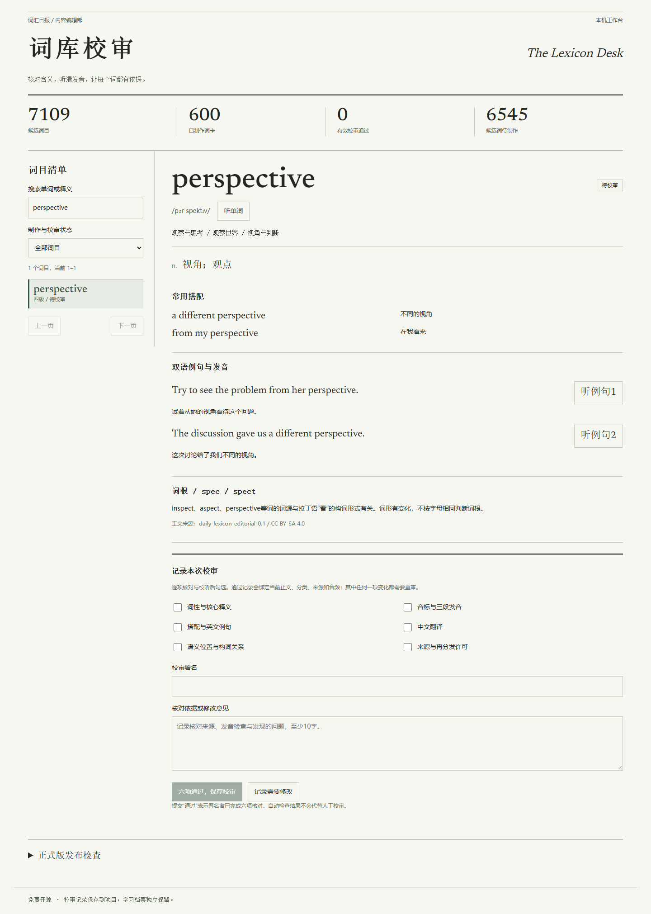

# 词汇日报 · The Daily Lexicon

免费、开源、离线的英语背词程序，支持Windows与安卓。界面采用报头、分栏、细版线与衬线字。

项目已结束试用阶段，进入 **1.0正式版开发**。当前构建为`1.0.0-dev.1`，继续支持已有学习档案。正式发行前的工作与验收条件见[1.0开发任务书](docs/1.0开发任务书.md)。

[源码](https://github.com/AliothChen555-star/daily-lexicon) · [程序许可](LICENSE) · [内容许可](content/LICENSE.md) · [验证记录](docs/验证记录.md)

[](https://github.com/AliothChen555-star/daily-lexicon/actions/workflows/ci.yml)


## 当前功能

- 默认每日30个课程词，可设5至100词；未完成词次日优先，到期复习另计。
- 按语义完整读一遍，再按词根与词族完整读一遍，最后全量乱序；乱序可重复多轮。
- 翻卡与四档自评，FSRS-6复习，撤销、搜索、三级语义筛选、收藏、笔记和学习档案。
- 600张已有词卡，音标、核心释义、至少两个双语搭配、两条双语例句及1800段离线发音。
- 20个主题、56个场景、124个概念；词根、现代词族与独立词分别说明，全部参加第二轮。
- 设备本地保存，JSON备份导入导出；0.1、0.2和0.3档案继续兼容。
- SQLite词卡数据库、本机校审工作台、内容变更后重审和正式发行检查。

## 安装开发构建

Windows解压`词汇日报-1.0.0-dev.1-Windows-x64.zip`，打开其中的`词汇日报.exe`。适用Windows10/11的64位电脑，保留同一文件夹的全部文件，无需开发工具。

安卓安装`词汇日报-1.0.0-dev.1-Android.apk`。最低Android8.0，需较新的Android System WebView。当前开发包沿用旧开发签名，已编译及校验，仍待实体设备验证。

日期按北京时间划分。备份、换设备和重装前可在“学习档案”导出记录。首次使用第二台设备时先导入同一份备份，交替使用并交换最新文件；目前没有自动同步。

## 从旧版升级

应用版本、内容修订版本与课程范围版本分别管理。本次分别为`1.0.0-dev.1`、`0.3.1`、`0.3.0`。内容修订统一参考层级，保持原有600词标识与课程范围。

- 从0.3升级：原轮次、顺序、评分、复习、当天配额、收藏和笔记保留；不会因应用版本升级重开一轮或显示“增补0词”。
- 从0.1或0.2升级：原语义轮分别追加480或300词，保留当天原计划；旧词根或乱序轮先按原120或300词范围完成，再进入600词语义轮。
- 备份继续使用v2格式。`contentVersion`保留原有课程范围含义，新增`contentRevision`记录正文修订；同为600词范围时仍兼容0.3备份。0.1与0.2不支持600词范围。

## 词库制作与校审

候选拼写并集为7,109词；已制作600卡，其中564卡与候选相交、36卡为扩展词，另6,545候选词待制作。候选词不计作完整词卡，也不显示为可背的空卡。

全部已制卡按固定来源标签统一参考层级：基础452词、四级74词、六级38词，另36词单列扩展。此前试制分层已统一纠正；它仍不能代替正式大纲逐词核对。音频为本地合成，600张卡尚待完整人工校审。

候选范围只采用ECDICT的拼写和标签，保留固定提交、SHA-256和MIT许可，未复制其释义、音标、例句或音频。详见[范围报告](content/reports/scope.md)。官方词表核对、差异词裁定、全量成卡、逐卡校审与平台验收见[发行检查](content/reports/release.json)。

本机启动校审工作台：

```powershell
npm ci
npm run content:build
npm run editorial
# 打开 http://127.0.0.1:4175
```



工作台支持搜索、分页及待制作／待校审／已通过／需修改／待重审筛选。可核对完整词卡、听取三段音频、勾选六项校审、填写署名与依据，保存至`content/reviews.json`。正文、原稿、语义位置、构词说明、来源或实际音频变更后，原通过记录失效。此工作台仅本机访问，不读取学习档案，也不调用收费接口。自动测试仅在临时目录写入虚构审核数据。

修改词卡原稿后，重新运行内容构建；例句变化时先删除对应旧WAV再合成，随后校审。已有通过记录不会自动转移到修改后的内容。结构检查不会自动标记人工通过。

## 正式发行检查

```powershell
npm run release:check
```

该命令重新生成词包、校对报告与数据库，检查正式范围、覆盖、差异词、参考层级、有效人工校审、原稿一致性、音频、结构报告、当前安装包验证及签名分发。未完成时返回退出码2并列出待办。当前明确未满足1.0正式发行条件；开发构建仍可使用。`create-delivery.py`在1.0及以上稳定版本打包前强制执行相同检查。

## 开发与构建

应用使用React与TypeScript，Windows使用Electron，安卓使用Capacitor。学习事件与个人内容保存在IndexedDB；内容流水线生成SQLite查询库和同版本JSON离线快照，校审工作台直接查询SQLite，学习界面使用JSON快照。数据库与快照的内容校验值及全部词卡由测试核对，学习档案独立管理。

需要Node.js24、npm与Python3.12（内容工具只依赖标准库）。安卓构建另需JDK21、Android SDK36。

```powershell
npm ci
npm run content:build
npm test
npm run build
npm run test:ui
npm run dev
npm run package:windows
npm run android:sync
# 使用已配置的工具目录：
./scripts/build-android.ps1 -ToolchainRoot <工具目录>
```

也可在`android/local.properties`配置`sdk.dir`，设置`JAVA_HOME`、`ANDROID_HOME`后在`android`目录运行`./gradlew.bat assembleDebug`。APK输出为`android/app/build/outputs/apk/debug/app-debug.apk`。Windows与界面测试使用隔离档案；校审测试服务端口为4176，自动建立临时词库。

## 内容工程

| 路径 | 用途 |
| --- | --- |
| `content/editorial/*.tsv` | 原创词卡，每行9列，以竖线分隔 |
| `content/semantic.json` | 主题、场景、概念及语义顺序 |
| `content/groups-*.json` | 现代词族和独立词说明 |
| `content/batches` / `content/catalogs` | 编辑批次来源、历史词目快照 |
| `content/pack.json` | 内容修订、课程范围、数量与许可 |
| `content/reviews.json` | 与内容指纹绑定的校审历史 |
| `content/release-policy.json` | 范围裁定、平台验收与发行依据 |
| `public/lexicon.sqlite` | 候选、词卡、搭配、例句、词形、语义、构词与校审数据库 |
| `src/data/content.json` | 客户端离线快照 |
| `public/audio` | 1800段WAV及文本、音素、时长、哈希清单 |
| `scripts/content_core.py` | 校审、数据库生成与正式发行检查 |
| `editorial` | 独立校审工作台，不进入日常学习导航 |

离线音频已包含在源码中。重新合成需要`requirements-audio.txt`中的开源工具和`en_US-ljspeech-medium`模型，可运行`scripts/download-voice.py`、`scripts/generate-audio.py`。模型和工具来源见`content/audio-provenance.json`；合成有随机性，清单保存实际输出的校验值。

## 开源许可

程序GPL-3.0-only；原创词卡、例句、图标及合成音频CC BY-SA4.0；Newsreader与Noto Serif SC字体OFL-1.1。Piper工具GPL-3.0，LJSpeech训练数据依模型卡声明为公共领域。依赖及许可见[第三方声明](THIRD_PARTY_NOTICES.md)和`public/licenses`。

不加入广告、收费接口、题库或语法教学。正式版后续开发以完整词库、可靠离线学习、跨设备使用和可追溯内容为重点。
